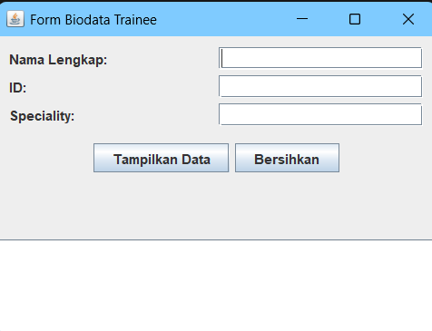

# Form Biodata Trainee (Java Swing GUI)

Aplikasi desktop sederhana berbasis **Java Swing** untuk mencatat dan menampilkan data biodata *trainee* (Nama Lengkap, ID, dan *Speciality*). Program ini menerapkan konsep Pemrograman Berorientasi Objek (OOP) serta hirarki komponen GUI di Java.

---

## Fitur & Konsep yang Diterapkan

* **Konsep OOP:**
  * **Inheritance (Pewarisan):** Class `FormTrainee` mewarisi (`extends`) `JFrame` untuk bertindak langsung sebagai jendela utama aplikasi
  * **Encapsulation (Enkapsulasi):** Seluruh atribut komponen GUI dibungkus dengan modifier `private` dan diinisialisasi melalui *constructor* serta *method* terstruktur (`komponenVisual()` dan `aksiReaksi()`).
  * **Anonymous Object:** Pemanggilan jendela di dalam `main()` dilakukan secara ringkas menggunakan `new FormTrainee().setVisible(true);`
* **Struktur Hirarki GUI:**
  * **Top-Level Container:** `JFrame` sebagai bingkai utama aplikasi
  * **Intermediate Container:** `JPanel` untuk mengelompokkan area input dan tombol, serta `JScrollPane` untuk membungkus area hasil agar mendukung fasilitas *scroll*
  * **Atomic Components:** `JLabel`, `JTextField`, `JButton`, dan `JTextArea`
  * **Layout Manager:** Kombinasi `BorderLayout` (pada frame utama) dan `GridLayout` (pada panel form input).
  * **Event Handling:** Menggunakan `ActionListener` untuk menangani aksi klik pada tombol **Tampilkan Data** dan **Bersihkan**.

