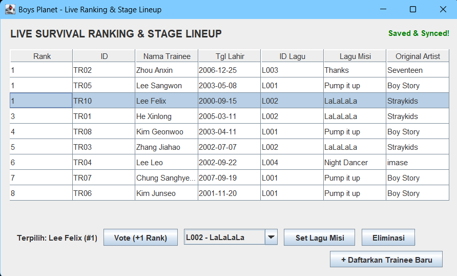
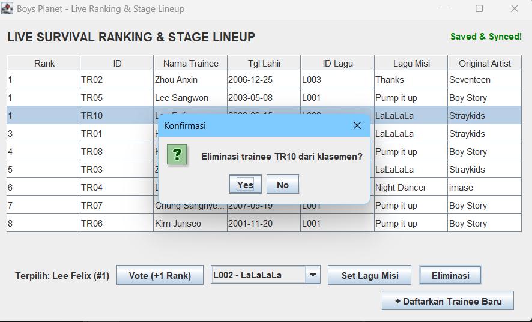
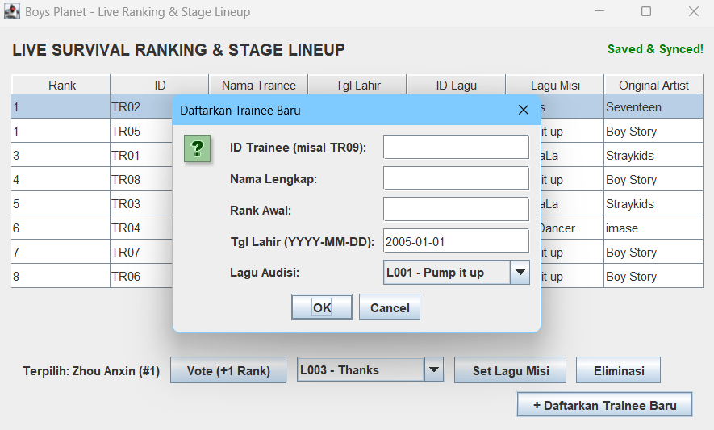

# demo

## 1. Tampilan utama
Menampilkan papan klasemen trainee terurut berdasarkan peringkat tertinggi beserta lagu misi dan penyanyi aslinya, dilengkapi tombol interaksi cepat dan status sinkronisasi database (`Saved & Synced!`).

## 2. Konfirmasi Eliminasi Trainee (delete)
Menampilkan dialog konfirmasi keamanan (`JOptionPane.showConfirmDialog`) sebelum menghapus data peserta dari klasemen dan database.

## 3. Form pendaftaran (Create)
Form input berbasis dialog untuk mendaftarkan trainee baru dengan pilihan lagu misi yang diambil langsung dari tabel relasi `lagu`.

untuk update menggunakan tombol vote, rank akan terupdate, dan set lagu misi untuk update lagu misi yang akan ditampilkan

### 1. Daftar Kelas (`src/`)
* **`Koneksi.java`**: Mengelola konfigurasi dan pembukaan koneksi ke database MySQL (`jdbc:mysql://localhost:3306/bp`) menggunakan `DriverManager` serta memuat driver `com.mysql.cj.jdbc.Driver`.
* **`Trainee.java`**: Kelas model (*POJO*) yang merepresentasikan entitas data trainee beserta atribut hasil relasi lagu (`idTrainee`, `nama`, `rank`, `tglLahir`, `idLagu`, `judulLagu`, dan `ogSinger`) lengkap dengan *constructor* dan *getter*.
* **`TraineeDAO.java`**: Mengimplementasikan pola **Data Access Object (DAO)** untuk seluruh operasi database:
  * **Read (`getSemuaKlasemen`, `getDaftarLagu`)**: Mengambil data klasemen menggunakan query `INNER JOIN` antara tabel `trainee` dan `lagu` dengan `PreparedStatement` dan `ResultSet`.
  * **Create, Update, Delete (`tambahTrainee`, `updateRank`, `updateLagu`, `hapusTrainee`)**: Menjalankan manipulasi data menggunakan **JDBC Transaction** (`conn.setAutoCommit(false)`, `conn.commit()`, dan `conn.rollback()` saat terjadi `SQLException`) untuk menjaga konsistensi data.
* **`SurvivalFrame.java`**: Kelas tampilan utama yang mewarisi (`extends`) `JFrame`. Menggunakan kombinasi `BorderLayout` (`NORTH`, `CENTER`, `SOUTH`), `FlowLayout`, `JTable` di dalam `JScrollPane`, serta `JOptionPane` untuk interaksi input dan dialog konfirmasi.
* **`Main.java`**: Kelas titik masuk (*entry point*) program yang menjalankan `SurvivalFrame` di atas *Event Dispatch Thread* melalui `SwingUtilities.invokeLater(...)`.

### 2. Penerapan Multithreading & Sinkronisasi UI
* **Background Thread (`new Thread(...)`)**: Setiap proses baca/tulis ke database MySQL dijalankan pada *thread* terpisah di latar belakang agar tampilan jendela aplikasi tidak membeku (*freeze*) saat menunggu respons query.
* **Event Dispatch Thread (`SwingUtilities.invokeLater(...)`)**: Pembaruan komponen visual seperti pengisian baris `DefaultTableModel`, pengaturan status tombol, dan perubahan label indikator (`Loading...` $\rightarrow$ `Saved & Synced!`) dikembalikan ke jalur EDT agar aman dari konflik antar-*thread*.

